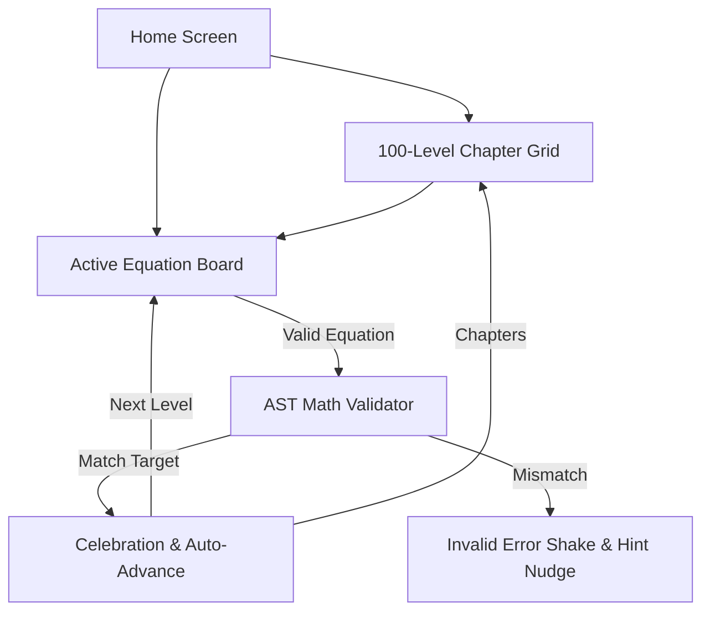
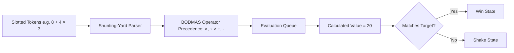

# Number Builder: Game Documentation & Technical Architecture


> **Tactile Geometric Math Puzzle for Ages 3–12**  
> *Built with React 19, TypeScript, Tailwind CSS v4, and the Web Audio API.*

---

## 1. Product Overview & Vision

**Number Builder** is an educational arithmetic construction puzzle designed for children aged 3–12. Unlike high-pressure arcade math games with timers and rapid fail-states, Number Builder offers a calm, tactile architectural studio aesthetic.

### Core Philosophy
* **Tactile Feedback**: Acrylic and wooden magnetic blocks with realistic 3D bevels, physical drop shadows, and magnetic snapping.
* **Acoustic Design**: Crisp wooden clicks, mechanical snaps, soft low thuds on error (never harsh buzzers), and an ambient lo-fi kalimba soundtrack generated procedurally.
* **Cognitive Growth**: A structured 10-World curriculum (100 levels) progressively building mathematical confidence from kindergarten addition to multi-step pre-algebra.

---

## 2. Architectural Design & Pipeline



### Component Breakdown
* [`HomeScreen.tsx`](src/components/HomeScreen.tsx): Main entry screen featuring the official 3D block logo, audio toggles, star stats, and level navigation.
* [`ChapterGridScreen.tsx`](src/components/ChapterGridScreen.tsx): 10-world progression map tracking sequential level locks, stars earned (0–3), and chapter badges.
* [`EquationBoard.tsx`](src/components/EquationBoard.tsx): The core puzzle screen managing dual-input mechanics (tap-to-slot and drag-to-slot), tray tiles, and target validation.
* [`CelebrationModal.tsx`](src/components/CelebrationModal.tsx): Post-solve celebration with canvas-confetti particle burst, star animation, and next-level progression.
* [`Tile.tsx`](src/components/Tile.tsx) & [`Slot.tsx`](src/components/Slot.tsx): Physical-inspired UI elements with 3D bevels, magnetic indicators, and locked/anchor states.
* [`FloatingGeometrics.tsx`](src/components/FloatingGeometrics.tsx): Calming ambient geometric polygons that slowly float and rotate in the background.

---

## 3. Math Engine & Expression Evaluator

The equation validation system is powered by [`MathEvaluator`](src/game/math/evaluator.ts) implementing Dijkstra's **Shunting-Yard Algorithm**:



### Supported Equation Variations
* **Commutativity**: Any valid permutation is recognized. For example, to make $10$ with tiles `2`, `3`, `5`, both $2 + 3 + 5$ and $5 + 3 + 2$ are accepted.
* **Strict Operand Order**: Subtraction and division enforce directional validity (e.g. $15 - 7 = 8$ is accepted; $7 - 15 = -8$ is rejected).
* **Precedence Rules**: Multiplications and divisions evaluate before additions and subtractions.

---

## 4. 100-Level Curriculum (Ages 3–12)

| World | Title | Age Focus | Educational Objective | Sample Equation |
| :---: | :--- | :---: | :--- | :--- |
| **1** | Starter Workshop | Ages 3–5 | Single-digit sums with pre-filled `+` | `[ ] + [ ] = 5` |
| **2** | Addition Atelier | Ages 5–6 | Double-digit addition with distractor tiles | `[ ] + [ ] = 17` |
| **3** | Subtraction Studio | Ages 6–7 | Subtraction ordering & minuend understanding | `[ ] - [ ] = 8` |
| **4** | Trio Tower | Ages 7–8 | 3-number additive combinations | `[ ] + [ ] + [ ] = 10` |
| **5** | Multiplication Mill | Ages 8–9 | Factors and multiplication facts | `[ ] × [ ] = 20` |
| **6** | BODMAS Bridge | Ages 9–10 | Mixed operations & precedence rules | `[ ] + [ ] × [ ] = 20` |
| **7** | Division Foundry | Ages 9–10 | Whole-number integer division | `[ ] ÷ [ ] = 6` |
| **8** | Architect Academy | Ages 10–11 | Four-operation equations with locked anchors | `20 + [ ] ÷ [ ] = 23` |
| **9** | Master Blueprint | Ages 11–12 | Flexible placement of numbers and operators | `[ ] × 5 - [ ] = 40` |
| **10** | Infinity Vault | Ages 11–12 | Zero property, identity property, grand finale | `[ ] × 0 + [ ] = 5` |

---

## 5. Procedural Studio Audio Engine

To eliminate bulky external audio asset downloads, Number Builder uses a high-performance **Web Audio API Sound Engine** ([`soundEngine.ts`](src/game/audio/soundEngine.ts)):

1. **Ambient Kalimba BGM**: A generative 4-chord progression ($C \to Am \to F \to G$) synthesizing bell tines with 3.2× overtones and gentle reverberation.
2. **Tile Click**: A bandpass-filtered triangle wave providing a tactile wooden tap upon touch.
3. **Magnetic Snap**: Dual-frequency transient click ($1200\text{Hz} \to 240\text{Hz}$) with acoustic wood resonance.
4. **Invalid Thud**: Low-pass filtered $130\text{Hz}$ downward sweep providing a soft, non-punitive rattle.
5. **Victory Chime**: An arpeggiated 5-note C-Maj9 chord cascade ($C_4, E_4, G_4, B_4, D_5$) with stereo spread.

---

## 6. Mathematical Solvability Verification

An automated solver test ([`levels.test.ts`](src/game/levels/__tests__/levels.test.ts)) checks all 100 levels by testing permutations of available tray tiles against open slots:

```bash
npm test
```

### Test Suite Output
```text
✓ MathEvaluator > correctly evaluates simple operations
✓ MathEvaluator > respects BODMAS precedence: multiplication before addition
✓ MathEvaluator > handles division precedence and rejects division by zero
✓ MathEvaluator > validates targets with commutative variations
✓ 100-Level Solvability Suite > contains exactly 100 levels spanning 10 worlds
✓ 100-Level Solvability Suite > guarantees every single level from 1 to 100 has at least 1 valid solution

Test Files  1 passed (1)
Tests       6 passed (6)
```

---

## 7. Development & Deployment

### Prerequisites
* Node.js v18+ (tested on v26)
* npm v9+

### Commands
```bash
# Install dependencies
npm install

# Start local dev server
npm run dev

# Run unit tests and 100-level solver verification
npm test

# Build production bundle
npm run build

# Preview production build locally
npm run preview
```

### Production Build Metrics
* **Total JS**: 293 kB (89 kB gzipped)
* **Total CSS**: 53 kB (8.6 kB gzipped)
* **Zero external network requests** for sounds or icons (standalone offline playable).
